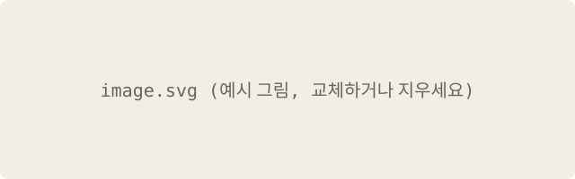

---
# 폴더 글 템플릿. pnpm new <slug> --folder 로 posts/YYYY-MM-DD-<slug>/ 를 만들거나, 폴더째 복사해 이름을 바꿉니다.
# 이 폴더의 .md가 아닌 파일(그림 등)은 글 주소 옆에 그대로 복사됩니다.
# 폴더 이름의 날짜가 게시일, 뒤쪽이 주소(/posts/<slug>/)입니다. slug는 영어 소문자, 숫자, - 만.
title: "제목"                          # 필수. ': '이나 ' #'이 들어가면 따옴표로 감쌉니다
description: "목록과 검색 결과에 보일 한 줄 요약"  # 선택. 없으면 본문 앞 160자
category: 카테고리                      # 선택. 글마다 하나
tags: [태그 하나, 태그 둘]              # 선택. 여러 개는 꼭 [ ] 목록으로 (tags: a, b 로 쓰면 빌드 에러)
# updated: 2026-01-02                  # 선택. 고친 날짜 (게시일과 같거나 이후)
draft: true                            # 공개할 때 이 줄을 지우거나 false로
---
첫 문단. 아래는 쓸 수 있는 문법 모음입니다. 필요 없는 부분은 지우세요.

## 소제목 (##과 ###은 목차에 들어감)

**굵게**, *강조(형광펜)*, ~~취소선~~, `인라인 코드`, [링크](https://example.com), [사이트 안 다른 페이지](/tags/), [이 글의 절](#소제목-과-은-목차에-들어감)

- 목록
  - 중첩 목록
1. 번호 목록
- [ ] 할 일
- [x] 끝난 일

| 왼쪽 | 가운데 | 오른쪽 |
|:--|:--:|--:|
| a | b | c |

각주는 이렇게 씁니다.[^1]

> [!NOTE]
> 알림 종류: NOTE, TIP, IMPORTANT, WARNING, CAUTION. 첫 줄에는 표시만 둡니다.

### 코드

```ts title="file.ts" {2} showLineNumbers
const a = 1
const b = 2 // 2번 줄 강조
console.log(a + b) // [!code ++]
```

### 수식과 다이어그램

인라인 $e^{i\pi} + 1 = 0$, 달러 기호는 \$5처럼 씁니다.

$$
\sum_{k=1}^{n} k = \frac{n(n+1)}{2}
$$


### 그림

그림 파일을 이 폴더에 넣고 상대 경로로 씁니다. 그림만 있는 문단은 그림(figure)이 되고, 따옴표 안에 제목을 쓰면 그 제목이 캡션으로 붙습니다.



여러 글이 같이 쓰는 그림은 static/img/에 두고 `/img/파일.png`로 씁니다.

[^1]: 각주 내용은 글 맨 아래에 모입니다.
